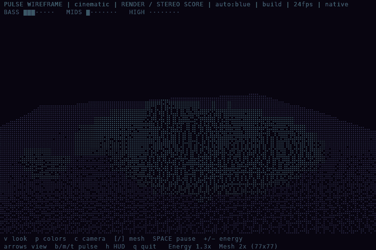

# Pulse TUI

Audio-reactive 3D wireframe terrain, rendered entirely in your terminal. Powered by [CAVA](https://github.com/karlstav/cava), with stereo terrain, musical camera choreography, crest highlights, a traveling history of the song, and rhythm-guided Braille colors.



*Actual terminal renderer. The smooth reference clips are 24 fps; this inline GIF
is 12 fps. All showcase recordings use a labeled, deterministic stereo spectrum
score rather than a captured song.*

[Open the earlier cinematic stages and experiments](docs/media/showcase/index.html) ·
[Compare all eight looks](docs/media/showcase/comparison.png) ·
[Preset guide and fallback commands](docs/showcase.md)

## Quick start

Requires Python 3.10+, NumPy, and CAVA. On macOS, use a true-color terminal such as iTerm2:

```sh
brew install cava
git clone https://github.com/tjcanro/pulse-tui.git
cd pulse-tui
python3 -m venv .venv
.venv/bin/python -m pip install -r requirements.txt
./Pulse.command
```

Pulse uses live audio from CAVA. You can also double-click `Pulse.command` in Finder to start it. macOS may request system-audio capture permission for CAVA.

## Looks and fallbacks

**Cinematic is the default**: a restrained musical camera, stereo pulse placement,
bright crests, trailing terrain history, and buildup/release waves. Quiet passages
pull back; busier passages move the camera lower and closer. There is no per-beat
camera shake.

```sh
./Pulse.command                         # Selected cinematic look
./Pulse.command --look classic --mono    # Previous geometry and camera
./Pulse.command --look crests            # Step 1: crest accents only
./Pulse.command --look memory            # Step 2: crests + terrain history
./Pulse.command --look ember             # Warm, broad, gentle
./Pulse.command --look neon              # Sharp, vivid, energetic
./Pulse.command --look deep-space        # Blue, spacious, slow
./Pulse.command --look surge             # Preserved stronger-motion experiment
```

Press **`v`** to cycle all fourteen looks, including the six new color themes. Changing looks applies its camera, palette,
mesh density, and response defaults; explicit CLI options override those defaults
at launch. `--no-history`, `--no-highlights`, `--no-sections`, `--mono`, and
`--camera fixed` let you pare individual effects back. Feature-disable flags stay
in force when cycling looks. See [the rendering gallery](docs/showcase.md).

## Audio-only character and livelier colors

Auto combines bass character with repeating, broad high-band percussion. It can
now reach **all nine palettes** instead of relying mainly on Warm and Neon.

| Musical pattern | Favored palette |
| --- | --- |
| Rounded acoustic/country-like bass, sparse percussion | Ember |
| Sustained sub-bass with dense hip-hop-like hats | Crimson |
| Repeating offbeat bass locked to Latin-like percussion subdivisions | Aurora |
| Regular broad/descending electronic kicks | Neon |
| Pitched bass with regular pop-like percussion | Blue |
| Moving bass notes and swung percussion | Gold |
| Sustained sub-bass with sparser soul-like percussion | Violet |
| Bright, dense dance-pop-like percussion | Sunset |
| Very still, diffuse ambient low end | Ice |

A vocal entrance or overall brightness alone does not steer the family. Upper
percussion must show broad attacks, envelope recurrence, and agreement across
multiple bars. Confidence, dwell, and slow color blending prevent abrupt jumps.
Aurora also requires a repeating bass phrase with substantial offbeat activity;
omitted notes or a brief pickup in country/acoustic bass are insufficient. Gold
requires alternating short/long percussion, rather than irregular timing from
missed hi-hat detections. Rounded acoustic bass can therefore stay Warm even with
busy drums.
The whole spectrum still animates lightness, chroma, and related hues within the
family. All analysis stays local, with **no metadata or player setup**. These are
musical-pattern heuristics, not a trained genre classifier; mixed recordings may
fit more than one profile.

```sh
./Pulse.command                         # Automatic, cinematic
./Pulse.command --color-response 1.8    # More lively color movement
./Pulse.command --palette warm         # Lock family; retain expression
./Pulse.command --look aurora
./Pulse.command --look crimson
./Pulse.command --look gold
./Pulse.command --look velvet
./Pulse.command --look sunset
./Pulse.command --look glacier
```

There are now **nine palettes and fourteen looks**. `p` cycles palettes; `v`
cycles looks. Fixed palettes/looks override automatic family selection. For auto,
use the default Cinematic look or `--palette auto`.

[Watch the four automatic styles](docs/media/styles/index.html) ·
[See all nine quiet/lively palettes](docs/media/character/atlas.png) ·
[Read the analysis, controls, and limitations](docs/character.md)

## Cycle through every palette

```sh
party --palette cycle                    # Smooth, continuous palette loop
party --palette cycle --cycle-seconds 8  # Faster: eight seconds per family
```

Cycle visits all nine families in a color-wheel order, easing between them.
The default is **14 seconds per family** (126 seconds for a full loop); the
supported range is 2–120 seconds per family. It keeps the current music intensity
response and continues through silence. Space pauses both the scene and cycle.
`p` cycles **Auto → Cycle → fixed families**.

Auto also now evaluates a rolling bass window, removes the sustained per-bin
bed when finding a pulse, and can use periodicity even when individual attacks
are weak. This fixes cases where short kicks, compressed bass, or a continuous
bass line caused Auto to stay warm. When a new family is blending in, the HUD
shows the transition, for example `auto:warm>neon`.

## Mesh coarseness

Press **`]` for a finer mesh** with smaller gaps, or **`[` for a coarser mesh**. The footer shows the current density and grid dimensions. Density changes work while paused, so you can compare the same frame.

The default is **2x**, a **77x77** vertex grid. The original prototype used a **39x39** grid (now `1x`). Density scales the number of edges along each axis: twice the density roughly halves the spacing and quadruples the number of triangles. The supported range is `0.5x` (20x20) to `4x` (153x153), in steps of `0.25x`.

```sh
./Pulse.command --mesh-density 3
./Pulse.command --mesh-density 4 --camera overhead
```

`--density` is an alias for `--mesh-density`. A higher density produces finer geometry; it costs more rendering time. The surface depth mask is rasterized from the same mesh as the visible edges to reduce false holes from the earlier sampled depth mask.

The dots themselves are Braille glyphs: increasing mesh density shrinks the spaces between wireframe edges, while individual-dot spacing still depends on terminal font and font size. A smaller terminal font gives more display detail.

## Ultrawide performance

The launcher automatically uses a small compiled C rasterizer for depth masking and wire drawing. Mesh geometry and density are unchanged. The header shows **native** when it is active. Unicode text encoding is batched, and unchanged terminal rows are not resent.

The native binary is built locally into `src/pulse_tui/_native/` and is excluded from version control. When needed, the launcher tries to rebuild it with an existing C compiler; it does not install a compiler. The portable Python path remains available if the library cannot load.

```sh
python3 scripts/build_native.py
./Pulse.command --python-renderer
```

In local checks at the default 2x mesh density, average renderer time fell from approximately **103 ms to 8 ms at 360x90**, and **159 ms to 12 ms at 480x110**. These are computation/encoding timings, not measured iTerm2 display frame rates. Actual smoothness also depends on terminal redraw performance, font size, and output throughput. The existing FPS counter includes terminal writes.

If a very large window remains slow, use `[` to reduce mesh density slightly, or increase the font size to reduce the number of terminal cells.

## Controls

| Key | Action |
| --- | --- |
| `]` / `[` | Finer / coarser mesh |
| `c` | Cycle musical choreography, flight, orbit, overhead, fixed |
| `v` | Cycle looks, including Classic and intermediate stages |
| `p` | Cycle adaptive colors / warm / blue / neon |
| Arrow keys | Adjust viewing angle and height |
| Space | Pause motion; mesh and camera controls remain available |
| `+` / `-` | Adjust response strength |
| `b` / `m` / `t` | Manually trigger a bass / mid / treble pulse |
| `h` | Hide/show controls |
| `q` or Ctrl-C | Quit and restore the terminal |

## Audio integration

The application starts CAVA as a child process using raw, 8-bit stereo output: 64 bands per channel (128 bytes per frame). It copies the input settings from `~/.config/cava/config` into a temporary configuration. Your CAVA config and iTerm2 settings are not modified. The child process and temporary config are cleaned up on normal exit or Ctrl-C.

Bass, mids, and highs drive different ripple widths and speeds. Sudden increases trigger pulses; sustained frequency amplitudes also shape the surface. This is an onset heuristic, not precise BPM tracking or instrument separation. Live capture errors are reported directly. Use `--mono` for mono input devices or to disable stereo capture/placement.

```sh
./Pulse.command --input-method coreaudio --source tap
./Pulse.command --config /path/to/cava/config
./Pulse.command --gain 1.1 --fps 24
./Pulse.command --duration 30
./Pulse.command --help
```

Resize the terminal at any time. The default frame-rate target is 24 fps; the measured rate appears in the header. Large terminals and fine meshes cost more rendering time.

## Portability and validation

Requires Python 3.10+, NumPy, CAVA, and a Unix-like true-color terminal with Braille font support. An existing C compiler enables native acceleration on other machines. The `.command` launcher is for macOS. Elsewhere:

```sh
python3 -m pip install -r requirements.txt
python3 scripts/build_native.py
PYTHONPATH=src python3 -m pulse_tui
python3 tests/test_app.py
python3 tests/test_colors.py
python3 tests/test_character.py
python3 tests/test_cinematic.py
```

Set `PULSE_PYTHON=/path/to/python3` to override the Mac launcher's interpreter.

Tests cover native/Python renderer parity, suppression of unchanged terminal rows, mesh density and screen coverage, triangle depth rasterization, CAVA raw framing, actual CAVA with generated PCM/FIFO input, terminal controls, resizing, and cleanup. The audio test uses generated input, not your microphone or system playback. Final appearance and system-audio permission still need evaluation in your iTerm2 session.

This is an independent front end consuming CAVA's existing raw interface. Sources: [CAVA](https://github.com/karlstav/cava), [raw output configuration](https://github.com/karlstav/cava/blob/1.0.0/example_files/config).

## Project layout

```text
src/pulse_tui/          Audio, scene, camera, renderer, terminal, and CLI modules
native/wireframe.c     Native rasterizer source
scripts/               Native build helper
tests/                 Renderer, audio-stream, and terminal integration checks
docs/                  Architecture, presets, colors, performance, and rendered gallery
Pulse.command          macOS launcher
Makefile               Build, run, and test commands
pyproject.toml         Python package metadata
```

Development commands: `make build`, `make run`, and `make test`. To install into an existing development environment, use `python3 -m pip install -e .`; the `pulse-tui` command is then available. Build native acceleration with `make build` before running. CAVA is an external runtime dependency.

For a step-by-step explanation of the Python/C boundary and how sound becomes Braille text, read [how Pulse works](docs/architecture.md).

More detail: [architecture](docs/architecture.md), [performance](docs/performance.md), and [roadmap](docs/roadmap.md).

## Shell shortcut

To use `party` as a shortcut, add an alias to your shell configuration (`~/.bashrc` for Bash or `~/.zshrc` for Zsh), replacing the path with your checkout:

```sh
alias party='"$HOME/Workspace/pulse-tui/Pulse.command"'
```

Reload your shell configuration, then run `party`. Arguments pass through, for example `party --mesh-density 3`.
