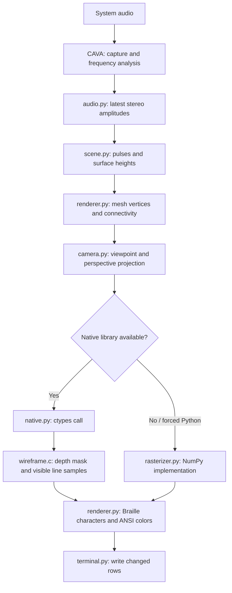

# How Pulse works

Pulse combines three pieces: CAVA analyzes audio in a separate process; Python
animates a 3D scene and manages the terminal; our optional C rasterizer accelerates
the conversion of projected geometry into visible dots. This is CPU rendering
into text, with no GLSL or GPU graphics API in the application.

## Follow one frame



`app.py` coordinates this pipeline. Each iteration reads controls, polls the
latest spectrum, updates the scene, reads the terminal dimensions, renders a
frame, writes changed rows, and sleeps for the remaining frame budget. The
default display target is 24 frames per second.

## Module map

| File under `src/pulse_tui/` | Responsibility |
| --- | --- |
| `app.py` | CLI arguments, startup, frame timing, coordination, and shutdown |
| `audio.py` | CAVA process, raw frame decoding, and background reader thread |
| `scene.py` | Energy-change detection, pulses, and animated surface heights |
| `colors.py` | Audio expression, family blending, and smooth bounded RGB updates |
| `character.py` | Bass timbre, pitch motion, periodicity, contrast, and stable character decisions |
| `rhythm.py` | Broad percussion onsets, envelope recurrence, and repeated multi-bar patterns |
| `style.py` | Bass-anchored musical profiles that make all nine automatic families reachable |
| `palettes.py` | Nine quiet/lively OKLCH gradients and sRGB conversion |
| `history.py` | Bounded stereo spectrum history, smoothly sampled toward the horizon |
| `director.py` | Continuous intensity/tension cues and conservative buildup/release heuristics |
| `looks.py` | Fourteen presets, including intermediate stages and the classic fallback |
| `camera.py` | Camera movement, viewing axes, and perspective projection |
| `renderer.py` | Mesh construction/cache, rasterizer selection, Braille encoding, and HUD |
| `native.py` | Load our shared library and declare its C function signature |
| `rasterizer.py` | Portable NumPy depth masking and visible line sampling |
| `terminal.py` | Keyboard controls, changed-row output, and terminal restoration |
| `settings.py` | Interactive options, camera choices, band count, and terminal colors |
| `__main__.py` | Entry point for `python -m pulse_tui` |

The accelerated loops live in `native/wireframe.c`. `scripts/build_native.py`
compiles them into `src/pulse_tui/_native/wireframe_native.so`, a local generated
file excluded from Git.

## 1. CAVA supplies frequency amplitudes

`CavaInput` runs the installed `cava` executable with a temporary configuration.
It inherits the user's input settings, requests 64 logarithmically spaced bands
from 40 Hz to 16 kHz, and keeps both stereo channels (or averages them with `--mono`). CAVA handles capture, Fourier
analysis, and its configured smoothing/autosensitivity. Pulse does not link to
`cavacore` or receive original PCM samples.

CAVA writes binary spectra to stdout at a requested 60 frames per second. Each
frame is 128 bytes: two channels of 64 amplitudes from 0 to 255. CAVA emits the left channel in descending frequency order and the right ascending; `StereoFrames` restores ascending order in both. `--mono` requests the previous 64-byte format. `RawFrames` handles reads
that contain partial or multiple frames and normalizes amplitudes to 0–1 floats.

A background thread drains the pipe. The display loop takes a locked copy of
the latest complete frame instead of queueing old frames. Audio and drawing
therefore run at different rates without building a playback delay. Intermediate
spectra can be skipped; this is not sample-accurate beat tracking.

## 2. Python turns sound into a surface

`Scene.update()` measures bass, midrange, and treble energy. A sufficiently large
increase relative to an adaptive threshold, subject to a cooldown, creates a
`Pulse`: a start time, position, frequency group, and strength. Positions are
procedural, not spatial audio localization.

`Scene.surface()` evaluates the height at each world-space `(x, z)` position.
It combines a small base undulation, expanding rings and decaying central mounds
from recent pulses, and a sustained-spectrum contribution. Frequency groups use
different ripple speeds and spacing. A second value, heat, controls coloring. Per-band stereo balance moves mids and treble sideways; bass stays closer to center. Mono or identical left/right input stays centered.

This is a height field: one vertical height per point on a horizontal grid. It
is an artistic audio response, not a physical fluid simulation or instrument
separator. Pulse ages change each rendered frame, keeping ripples moving between
new audio frames.

The cinematic looks also sample a bounded history of 192 stereo rows, recorded
at up to 12 Hz. Bilinear time/frequency interpolation moves previous audio toward
the horizon without discrete row jumps. A slow musical director tracks energy,
activity, and stereo balance. It can mark an approximate buildup/release and
launch a bounded expanding wave. These are visual heuristics, not exact song
section or BPM recognition. Geometry and camera controls are independent: the
camera has no beat shake, and rendering has no time-mutating side effects.

## 3. The grid becomes a 3D mesh

`Renderer.mesh()` places vertices on a square spanning -18 to 18 along both
horizontal axes. Density determines the number of vertices per axis:

```text
n = round(38 * density) + 1
vertices = n * n
triangles = 2 * (n - 1) * (n - 1)
```

At default density 2, `n` is 77: **5,929 vertices and 11,552 triangles**. Imagine
graph paper: intersections are vertices; each of its 76 by 76 squares splits
diagonally into two triangles. Horizontal, vertical, and diagonal vertex pairs
define visible wire edges.

Horizontal positions and connectivity are cached until density changes. Each
frame, Python/NumPy calculates new heights and heat values, lifting the grid into
a moving landscape. Triangles hide obscured lines even though the final picture
only draws edges.

`camera.py` chooses a viewpoint, transforms vertices into camera coordinates,
and applies perspective so distant geometry appears smaller. It returns screen
x, screen y, and camera depth per vertex. Both rasterizers receive these arrays. Local surface curvature adds brighter crest heat values, normalized by mesh spacing so density changes do not alter their strength. No extra geometry pass or C ABI change is needed.

## 4. What the native rasterizer does

Rasterization decides which discrete screen positions represent continuous
geometry. Our screen is a grid of potential Braille dots. `pulse_rasterize()`
performs two passes:

1. **Build a depth mask.** Visit positions inside each projected triangle and
   store the nearest surface depth. This buffer is invisible: it records which
   surface is in front at each position.
2. **Sample wire edges.** Walk along each projected line segment. Keep samples
   whose depth matches the visible surface, discard samples hidden behind nearer
   terrain, and interpolate their heat values.

For example, a nearby ridge hides the far side of a ripple. The depth mask keeps
the far-side wire from showing through. A small depth tolerance prevents rounding
differences from hiding an edge behind its own triangle. Depth interpolation
accounts for perspective.

The output dot grid uses -1 for empty positions and nonnegative heat values for
visible lines. `rasterizer.py` implements the equivalent operation in NumPy when
the library cannot load or `--python-renderer` is set.

### How Python calls C

The build helper invokes an existing C compiler with optimization enabled to
produce a shared library. Native means compiled machine code running on the CPU
inside the Python process. This library is ours, not CAVA's.

`NativeRasterizer` uses the standard `ctypes` module to load the library, check
its ABI version, and declare the C function's argument types. Every frame,
Python passes:

- Contiguous float64 arrays of projected x, projected y, depth, and heat.
- Int64 arrays of triangle vertex triples and edge vertex pairs, plus counts.
- Dot-grid width/height and writable float64 buffers for depth and dots.

`ctypes` passes pointers into those arrays' memory. There is no JSON serialization
or second rendering process: C writes directly into buffers allocated by Python.
The call is synchronous; Python continues encoding the frame after C returns.
`ascontiguousarray()` copies an input only when needed.

This moves expensive triangle/edge loops into C while leaving scene behavior,
camera movement, and controls in Python. NumPy also executes many array operations
in compiled code internally; Python describes the source and orchestration, not
a claim that every numeric operation is interpreted.

## 5. Dots become terminal text

One Unicode Braille character represents a 2-column by 4-row pattern: eight
possible dots. A drawing area of 120 columns by 36 terminal rows therefore uses
a 240 by 144 dot grid. Finer mesh geometry does not increase terminal resolution.

`Scene.update()` also feeds an independent color analyzer. `MusicCharacter`
extends the bass feature extractor with broad high-band percussion: it requires
at least eight onsets, six seconds of evidence, recurring envelopes, and
multi-bar pattern agreement before using that context. `style.py` combines the
context with sub-bass share, sustain, syncopation, pitch motion, and kick shape
to favor nine musical profiles. Vocal/body loudness alone does not choose a
family. One shared confidence/dwell/cooldown mechanism stabilizes the result;
these are heuristic profiles, not identified genres. The full spectrum drives
faster expression inside the palette, while family transitions take several
seconds. `Renderer.cells()` packs 2-by-4 blocks into characters
and heat indices; `Renderer.frame()` looks up twelve base colors plus four tinted crest accents in the current adaptive or fixed palette. See [music-adaptive colors](colors.md) for the wheel,
features, research, and limitations. Each character has one foreground color, so its eight
dots cannot have independent colors. `Renderer.frame()` adds ANSI color escapes
and the optional HUD.

`Terminal.draw()` compares rows with the previous frame and sends only changed
rows, using cursor-position escapes. iTerm2 draws the glyphs. On exit or Ctrl-C,
terminal settings, wrapping, cursor visibility, and the main screen are restored;
the CAVA child and temporary configuration are cleaned up. The user's CAVA and
iTerm2 settings are not edited.

## Read and check the code

Start with `app.py` for the whole frame loop. Follow `audio.py`, `scene.py`,
`renderer.py`, and `camera.py`. Read `rasterizer.py` for the numeric operation,
`native.py` for the language boundary, and `native/wireframe.c` for the accelerated
implementation. Finish with `terminal.py` for input/output and cleanup.

Run `make build` and `make test`. Tests cover actual CAVA/FIFO input, fragmented
raw frames, mesh density, depth masking, native/NumPy parity, changed-row output,
package CLI controls, resizing, and terminal restoration. Compare backends with
`./Pulse.command --python-renderer`.
