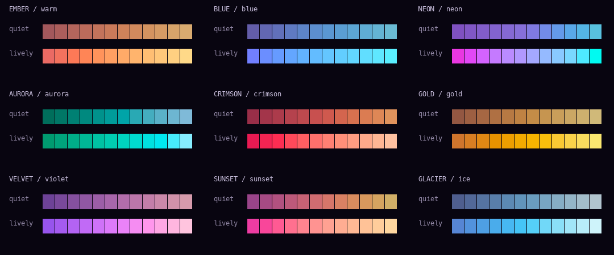

# Color reference

The current engine combines bass timbre/rhythm with qualified repeating
percussion for stable family selection, and uses full-spectrum expression for
stronger color changes. See the current
[audio-only character guide](character.md) for all nine families, fourteen looks,
controls, examples, and limitations.

## Continuous cycle mode

`party --palette cycle` gradually visits all nine families. Use
`--cycle-seconds 8` to adjust the seconds spent transitioning to each next family
(default 14, full loop 126 seconds). It follows scene time, continues through
silence, and freezes when paused. This mode is independent of Auto's decisions.

## Color wheel and expression

The families are constructed on an OKLCH wheel (hue angle, chroma, perceived
lightness). Within a gradient, hue follows the shorter arc. Quiet/lively gradients
and automatic families are blended in Oklab. Chroma is reduced into sRGB gamut
while preserving hue/lightness; bounded RGB steps add temporal smoothing.
The dark terminal background stays unchanged.

The family decision is anchored in approximately 40–120 Hz. Broad upper-band
attacks may add rhythmic context after several seconds of repeated patterns;
vocal/body loudness and overall brightness do not choose a family. The whole
spectrum animates each related quiet/lively gradient. Palette updates are bounded and
run at most eight times per audio-second. The renderer keeps twelve base colors
and four tinted crest accents. Silence holds colors; pause freezes analysis.

## Research versus artistic choices

Music-to-color experiments support associations mediated by perceived emotion,
including arousal. They do not prescribe universal genre colors. Our stronger
energy/expression mapping draws on that idea; Ember, Neon, and the other specific
hue ranges are artistic choices, not scientifically determined genre labels.

- Whiteford, Schloss, Helwig & Palmer (2018),
  [Color, Music, and Emotion: Bach to the Blues](https://pmc.ncbi.nlm.nih.gov/articles/PMC6240980/).
- Björn Ottosson, [A perceptual color space for image processing](https://bottosson.github.io/posts/oklab/):
  Oklab/OKLCH and the public-domain conversion matrices used here.
- W3C, [CSS Color 4: Oklab and OKLCH](https://www.w3.org/TR/css-color-4/#ok-lab).

The earlier [three-family preview](media/adaptive-colors.png) and
[cinematic experiment gallery](media/showcase/index.html) remain available as
historical renderings. The current [four-style comparison](media/styles/index.html)
uses controlled spectra; real-CAVA generated PCM fixtures also exercise the
analyzer in tests. Neither constitutes a real-song genre-accuracy evaluation.
